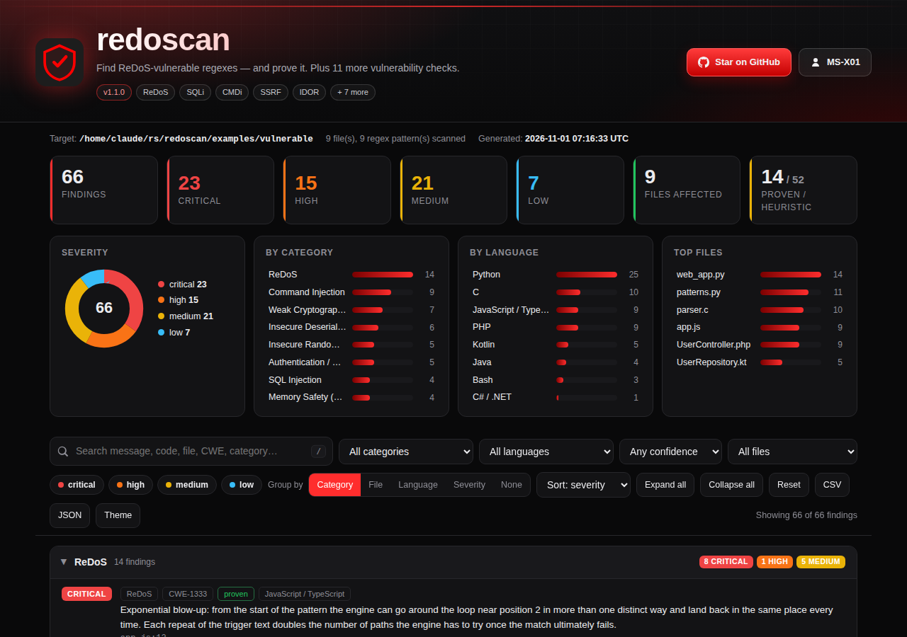
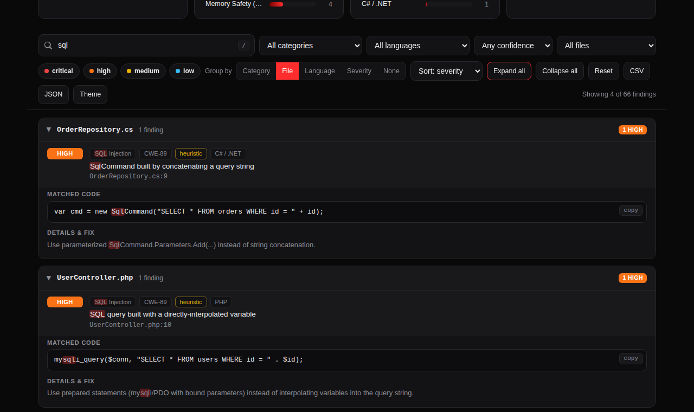
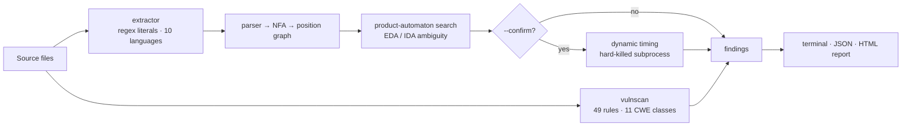

<p align="center">
  
</p>

<p align="center">
  <a href="https://github.com/MS-X01/redoscan/actions/workflows/ci.yml"></a>
  
  
  
  
  
</p>

<p align="center">
  <a href="#-quick-start">Quick start</a> ·
  <a href="#-the-html-report">HTML report</a> ·
  <a href="#-usage">Usage</a> ·
  <a href="#-cli-reference">CLI reference</a> ·
  <a href="#-how-it-works">How it works</a> ·
  <a href="#-faq">FAQ</a>
</p>

---

**redoscan** finds regular expressions that can hang your service (**ReDoS**) and — unlike most
"evil regex" checkers — *proves* it: it builds the pattern's automaton to find the ambiguity, then
optionally times the real regex engine to give you a measured number and a ready-to-paste
proof-of-concept input. On top of that it runs **49 fast pattern rules across 11 vulnerability
classes** (SQLi, command injection, SSRF, IDOR, deserialization, weak crypto, auth/session, DoS,
memory safety, …) and writes everything into **one searchable, filterable HTML report**.

> Zero dependencies. One command. One self-contained report you can open, search and share.

## ✨ Why redoscan

| | |
|---|---|
| 🔬 **Proof, not guesses** | ReDoS findings come from a product-automaton search (EDA / IDA), not a list of "scary shapes". Exponential vs. polynomial blow-up is told apart, and the standard fixes (atomic groups, possessive quantifiers) are recognised as *safe*. |
| ⏱️ **Confirm it for real** | `--confirm` times the pattern against the real engine in a hard-killed subprocess; `--poc` binary-searches the shortest input that takes >2 s. |
| 🧭 **Honest about confidence** | Every finding is labelled **proven** (automaton-backed) or **heuristic** (pattern-matched lead). The two are never mixed up. |
| 📊 **A report you actually want to read** | Search, filter, group by category / file / language / severity, export CSV or JSON — in a single `.html` file with no server and no external assets. |
| 🌍 **10 languages** | Python · JavaScript/TypeScript · PHP · Java · Kotlin · C# · C · Bash · Go · Ruby |
| 🚦 **CI-ready** | `--fail-on high`, JSON output, meaningful exit codes. |

## 🚀 Quick start

```bash
git clone https://github.com/MS-X01/redoscan.git
cd redoscan
pip install -e .
```

Scan a project — you get a compact summary in the terminal **and** an HTML report saved next to it:

```bash
redoscan ./src
```

Check a single regex, no files needed:

```bash
redoscan --pattern '^(a+)+$'
```

```text
CRITICAL 1
ReDoS: 1
1 location(s) flagged -- 1 pattern(s) scanned

────────────────────────────────────────────────────────────────
[CRITICAL] <cli>
  ^(a+)+$

     EDA  Exponential blow-up: from the start of the pattern the engine can go around the loop
          near position 2 in more than one distinct way and land back in the same place every time.
          sample: aaaaaaaaaaaaaaaaaaaaaa
```

Try it on the bundled examples (every language has a vulnerable file and a hardened twin):

```bash
redoscan examples/vulnerable      # finds 66 issues across 9 files
redoscan examples/safe            # clean
```

## 📊 The HTML report

Every scan saves `redoscan-report-<timestamp>.html` (turn off with `--no-html-report`).

<p align="center">
  
</p>

- **Overview at a glance** — severity cards, donut chart, and breakdowns by category, language and file. Click any bar or card to filter.
- **Live search** (press <kbd>/</kbd>) across message, code, file, CWE and category, with match highlighting.
- **Filters** for severity, category, language, file and confidence (proven / heuristic).
- **Group by** category, file, language, severity — or no grouping — with per-group severity badges.
- **Per-finding detail** — matched code or regex, attack sample with a copy button, CWE link, fix guidance, and the dynamic-confirmation result when you used `--confirm`.
- **Export** the current (filtered) view as CSV or JSON.
- **Light / dark theme**, responsive layout, print-friendly, no network access needed.

<p align="center">
  
</p>

## 🧰 Usage

| I want to… | Command |
|---|---|
| Scan a repo (ReDoS + all vulnerability checks) | `redoscan ./src` |
| Check one regex | `redoscan --pattern '^(a+)+$'` |
| ReDoS only / vulnerability checks only | `redoscan ./src --checks redos` · `--checks vulns` |
| Only some categories | `redoscan ./src --category sqli,cmdi` (see `--list-categories`) |
| Only serious findings | `redoscan ./src --min-severity high` |
| Only automaton-proven ReDoS | `redoscan ./src --confidence confirmed` |
| Prove a ReDoS finding by timing it | `redoscan ./src --confirm` |
| Get a shortest-hanging-input PoC | `redoscan ./src --poc` |
| JSON for tooling | `redoscan ./src -f json -o report.json` |
| Named HTML report | `redoscan ./src --html-report scan.html` |
| Gate a CI build | `redoscan ./src --fail-on high --no-html-report` |
| Full detail + list clean patterns | `redoscan ./src -v` |

## 📖 CLI reference

<details>
<summary><code>redoscan --help</code></summary>

```text
Usage: redoscan [OPTIONS] TARGET
       redoscan [OPTIONS] --pattern REGEX

redoscan 1.1.0 - find ReDoS-vulnerable regexes, and prove it.
Static automaton analysis + dynamic timing, plus pattern-based checks for
11 more vulnerability classes (SQLi, CMDi, deserialization, crypto, SSRF,
IDOR, DoS, auth, memory safety, ...) across 10 languages.

Target:
  TARGET                          file or directory to scan (omit when using
                                  --pattern)
  --pattern, -e REGEX             scan one regex given on the command line;
                                  repeatable (ReDoS checks only)
  --flags FLAGS                   flags applied to --pattern, e.g. 'i'
  --flavor {auto,python,js,pcre,dotnet}
                                  regex dialect to assume for --pattern
                                  (default: auto)

Analysis:
  --checks {all,redos,vulns}      what to run: ReDoS engine, the other
                                  vulnerability checks, or both (default: all)
  --category CATS                 limit vulnerability checks to these
                                  categories, comma-separated or repeated; see
                                  --list-categories
  --list-categories               print the available --category values and
                                  exit
  --confirm                       time each ReDoS finding against the real
                                  engine (slower; one subprocess per sample,
                                  hard-killed on timeout)
  --confirm-timeout SECONDS       per-sample timeout for --confirm (default:
                                  1.0)
  --poc                           print the shortest input that makes a
                                  confirmed finding take >2s (implies
                                  --confirm)

Filtering:
  --min-severity {critical,high,medium,low,info}
                                  only report findings at or above this level
                                  (default: info)
  --confidence {all,confirmed,heuristic}
                                  'confirmed' = automaton-proven ReDoS only;
                                  'heuristic' = pattern-matched leads only
                                  (default: all)

Output:
  --format, -f {terminal,json,html}
                                  primary output format (default: terminal)
  --output, -o FILE               write the primary report to FILE instead of
                                  stdout
  --save                          also save the primary report to an auto-
                                  named file
  --html-report FILE              write the HTML report to FILE (default:
                                  redoscan-report-<timestamp>.html)
  --no-html-report                do not auto-save the HTML report
  --verbose, -v                   full finding detail, and list clean patterns
                                  too
  --no-color                      disable ANSI colour

CI:
  --fail-on {critical,high,medium,low,any,never}
                                  exit 1 if a finding at or above this
                                  severity exists; 'never' always exits 0
                                  (default: high)

Misc:
  --version                       show version and exit
  --help, -h                      show this help and exit

Examples:
  redoscan ./src                          scan a project; also saves an HTML report
  redoscan --pattern '^(a+)+$'            check one regex, no files needed
  redoscan ./src --checks redos           ReDoS engine only
  redoscan ./src --category sqli,cmdi     only these vulnerability categories
  redoscan ./src --confirm                time each ReDoS finding against the real engine
  redoscan ./src --poc                    also print the shortest hanging input (PoC)
  redoscan ./src -f json -o report.json   machine-readable output
  redoscan ./src --fail-on high --no-html-report
                                          CI gate: exit 1 on critical/high, skip HTML

Exit status:
  0   no finding at or above --fail-on
  1   at least one finding at or above --fail-on
  2   usage error (bad option, missing target, unknown category)

Files:
  redoscan-report-<timestamp>.html        saved after every scan (see --no-html-report)

Docs:    docs/METHOD.md  (how it works; what "confirmed" vs "heuristic" means)
Project: https://github.com/MS-X01/redoscan
```

</details>

**Exit status:** `0` nothing at or above `--fail-on` · `1` at least one finding at or above `--fail-on` · `2` usage error.

## 🧠 How it works



The ReDoS engine tells shapes apart instead of flagging "any nested quantifier":

| Shape | Example | Cost |
|---|---|---|
| Nested unbounded quantifier | `(a+)+`, `(a*)*` | Exponential (EDA) |
| Overlapping alternation inside a loop | `(a\|a)+` | Exponential (EDA) |
| Optional group of an unbounded group before a required char | `([a-zA-Z0-9_.-]+)*@` | Exponential (EDA) |
| Adjacent unbounded groups with overlapping character sets | `\d+\d+`, `.*.*=.*`, `a*a*a*` | Polynomial (IDA) |

…and, just as importantly, what it correctly leaves alone:

| Fix | Example | Why it's safe |
|---|---|---|
| Atomic group | `(?>a+)+` | Backtracking is sealed off inside `(?>…)` |
| Possessive quantifier | `a++b` | Same effect as an atomic group |
| Non-overlapping adjacent groups | `[a-z]+\d+` | No character fits both, so there is only one valid split |
| Delimiter between repeated groups | `(a+b)+` | The `b` marks exactly where each iteration ends |

Full write-up, including every approximation: [`docs/METHOD.md`](docs/METHOD.md).

## 🛡️ What vulnscan covers

Pattern-based triage across 11 classes. Every finding carries a CWE, a one-line fix, and is tagged `heuristic` — a lead for a human to verify, not a verdict.

| Category | `--category` | CWE | Example trigger |
|---|---|---|---|
| SQL Injection | `sqli` | CWE-89 | `cursor.execute(f"SELECT … {id}")` |
| Command Injection | `cmdi` | CWE-78 | `os.system("cmd " + arg)`, `shell=True`, bash `eval` |
| Insecure Deserialization | `deser` | CWE-502 | `pickle.loads(…)`, `yaml.load(…)` |
| Weak Cryptography | `crypto` | CWE-327 | `hashlib.md5(password…)` |
| Insecure Randomness | `rand` | CWE-330 | `random.randint(…)` for a token |
| Path Traversal | `path` | CWE-22 | `include($_GET['page'])` |
| SSRF | `ssrf` | CWE-918 | `requests.get(request.args['url'])` |
| Broken Access Control (IDOR) | `idor` | CWE-639 | an `/{id}` route with no nearby auth check |
| Denial of Service | `dos` | CWE-400/409/776 | `extractall()` with no size check, XML entity expansion on |
| Auth / Session Weakness | `auth` | CWE-798/614/352/347 | hardcoded JWT secret, cookie without `secure`/`httponly`, `@csrf_exempt` |
| Memory Safety | `memsafety` | CWE-120/242 | C's `gets()`, `strcpy()`, `sprintf()` |

**Language support**

| Language | ReDoS (regex extraction) | Vulnerability rules |
|---|:-:|:-:|
| Python | ✅ | ✅ |
| JavaScript / TypeScript | ✅ | ✅ |
| PHP | ✅ | ✅ |
| Java | ✅ | ✅ |
| Kotlin | ✅ | ✅ |
| C# / .NET | ✅ | ✅ (subset) |
| C | ✅ | ✅ |
| Bash | ✅ | ✅ |
| Go | ✅ | — |
| Ruby | ✅ | — |

## 📦 Output formats

| Format | How | Use it for |
|---|---|---|
| Terminal | default | quick look; compact summary, 3 findings per location (`-v` for all) |
| HTML | auto-saved, or `-f html -o report.html` | reading, searching, sharing |
| JSON | `-f json -o report.json` | CI, dashboards, scripting |

<details>
<summary>JSON shape</summary>

```json
{
  "generated": 1793000000,
  "results": [
    {
      "location": "src/validators.py:14",
      "code": "^([a-zA-Z0-9_.-]+)*@",
      "severity": "critical",
      "findings": [
        {
          "kind": "EDA",
          "category": "redos",
          "confidence": "confirmed-by-analysis",
          "severity": "critical",
          "message": "Exponential blow-up: …",
          "attack_sample": "----------------------",
          "dynamic": null
        }
      ]
    }
  ]
}
```

</details>

## 🔁 CI integration

```yaml
name: redoscan
on: [push, pull_request]

jobs:
  scan:
    runs-on: ubuntu-latest
    steps:
      - uses: actions/checkout@v4
      - uses: actions/setup-python@v5
        with: { python-version: "3.12" }
      - run: pip install git+https://github.com/MS-X01/redoscan.git
      - run: redoscan . --fail-on high --html-report redoscan-report.html
      - uses: actions/upload-artifact@v4
        if: always()
        with:
          name: redoscan-report
          path: redoscan-report.html
```

The repo's own [`ci.yml`](.github/workflows/ci.yml) also self-scans the examples: `examples/vulnerable` must fail, `examples/safe` must pass clean.

## ⚠️ Limits worth knowing

- **ReDoS findings are about the regex's structure.** `--confirm` ties them to your actual engine; without it they are leads backed by an automaton, not a measurement.
- **vulnscan is pattern matching**, like a good `grep`-based linter: expect some false positives (a check lives in middleware) and false negatives (a check is present but wrong). IDOR especially is a business-logic flaw that syntax alone can't settle.
- **Not a DDoS detector.** Volumetric / network-layer attacks are an infrastructure problem (rate limiting, WAF/CDN, SYN cookies), not a source-code pattern. The `dos` category covers the code-level part: decompression bombs, XML entity expansion, unbounded request bodies.
- C and Bash regexes are POSIX flavours analysed with a PCRE-tolerant parser — a close approximation, noted in the report.

## ❓ FAQ

**Is a "heuristic" finding a real vulnerability?** It's a lead. Open the location, read the code, decide. "Proven" means the *automaton analysis* found ambiguity; add `--confirm` to measure it.

**Why is the tool called redoscan if it checks more than ReDoS?** ReDoS is the flagship and the most rigorous part; the other checks are a fast triage layer around it.

**Can I run it without the HTML report?** Yes: `--no-html-report`. For JSON only: `-f json --no-html-report`.

**How do I add a rule?** Add a `Rule(…)` in `src/redoscan/vulnscan.py`, a vulnerable and a safe line in `examples/`, and a test in `tests/test_vulnscan.py`. See [CONTRIBUTING.md](CONTRIBUTING.md).

## 🗂️ Project layout

```text
src/redoscan/
  parser.py         regex syntax → AST (Python / JS / PCRE / Java / .NET tolerant)
  nfa.py            AST → Thompson NFA → ε-free position graph
  engine.py         product-automaton search (EDA / IDA)
  dynamic.py        timing-based confirmation against the real engine
  extractor.py      pulls regex literals out of source files, 10 languages
  vulnscan.py       49 pattern rules, 11 CWE classes
  report.py         terminal / JSON / HTML data model
  html_template.py  the self-contained HTML report (search, filters, grouping, export)
  cli.py            argument parsing and orchestration
examples/           vulnerable/ and safe/ — matched pairs for 9 files
docs/METHOD.md      how it works and where each layer is an approximation
tests/              137 tests across every module
```

Run the tests: `pip install -e ".[dev]" && pytest -q`

## 🤝 Contributing & changelog

Bug reports, false positives and "this vulnerable regex slipped through" reports are the most valuable contribution — please open an issue (templates included). See [CONTRIBUTING.md](CONTRIBUTING.md) and [CHANGELOG.md](CHANGELOG.md).

## 👤 Author

Built by **Mohammad Sadra Naderi** ([MS-X01](https://github.com/MS-X01)), founder of ZVitoX — penetration testing, security research and software development.

<p>
  <a href="https://github.com/MS-X01"></a>
  <a href="https://www.linkedin.com/in/zvitox"></a>
  <a href="https://zvitox.medium.com"></a>
</p>

If redoscan helped you, a ⭐ on the repo is the best thank-you.

## 📄 License

MIT — see [LICENSE](LICENSE).
